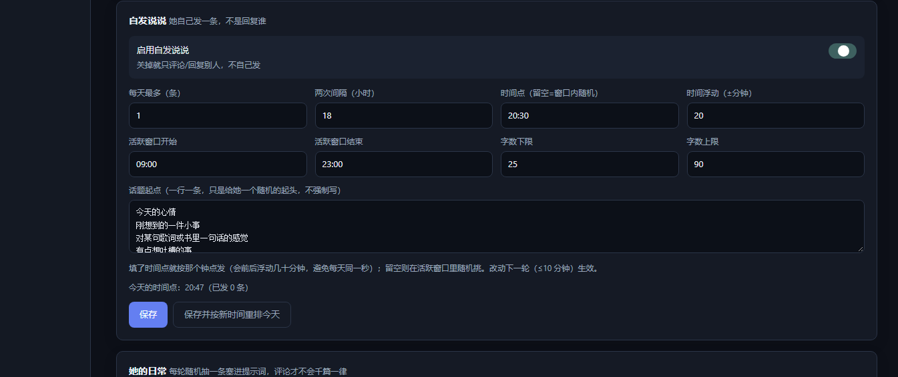

# 本仓库相对上游的改动

本仓库是 [shuang-ying/QQagent](https://github.com/shuang-ying/QQagent) v2.2.0 的二次开发副本。
上游未附 LICENSE，因此本仓库仅作个人使用与学习记录，不构成对上游代码的再授权。

## 一、源码修复

### `src/config/writer.ts` — YAML 标量写入的类型歧义

`formatValue()` 会把形如 `[A-Za-z0-9_./@+-]+` 的值裸写进 YAML，只排除了
`true/false/null/yes/no/on/off/~`，**没有排除数字形态**。于是这类字符串写入后再读回
会被 YAML 解析成数字：

| 写入的值 | 读回结果 |
|---|---|
| `398e3278` | `3.98e3278` → `Infinity` |
| `123` / `1e5` / `.5` / `+7` | 数字 |

后果：`speech.tts.voice` 这类字符串字段收到数字后会触发 zod 校验失败，
表现为 `POST /api/settings` 返回 400 `expected string, received Infinity`。

修复：数字形态与保留字一律加引号。

### 单实例保护

两个 Agent 同时运行会争抢同一条 OneBot 连接并写同一个 `brain.db`，表现为
"日志正常、没有报错、进程静默消失"。启动器层的端口检查挡不住 5 秒内连续两次
双击（第一次还没绑定端口），因此在两个层面各加一道：

1. `start-all.cmd` / `start-silent.cmd`：`runtime/agent.lock` 目录锁，
   `mkdir` 原子性保证只有一个赢家；存活 2 分钟内的锁视为有效，更早的视为崩溃残留
2. `src/index.ts`：启动时写 `runtime/agent.pid`，发现同名 PID 仍存活就打印提示并
   以退出码 1 终止，覆盖任务计划、手动 `npm start` 等其它入口

## 二、新增功能

### 空间动态：评论别人和回复评论解耦

- **回复用详情接口取评论**：`msglist_v6` 每帖只回传最近约 5 条评论，她回得多了别人的评论就
  被挤出视野（实测一帖 msglist 给 5 条、`msgdetail_v6` 给 16 条）。现在逐帖调详情接口，
  覆盖到之前看不见的评论。
- **一轮最多 1 条**：`minGapMinutes` 原本只在开跑前检查，一轮里可连发（实测 23:22:58 与
  23:23:02 两条只隔 4 秒）。改成按轮限流，实际间隔由 cron 的 10 分钟保证。
- **发送后回读校验**：`code:0` 不等于评论落地；发送后到详情接口里找自己那条，找不到就不记
  已回复、下一轮重试（避免"日志说已回复、空间里其实没有"，进而永久漏回）。
- **她自己的评论永远跳过**（第一道过滤），不会自问自答。
- 新增只读诊断：`--probe`（每帖可见评论数）、`--explain`（逐条说明会回/跳过原因）。
- `watch`（评论别人的说说）留空时不再 `fail`，而是**跳过这一段、继续做评论回复**
  （以前 watch 为空会直接退出，"只回复评论"根本跑不起来）。
- `replyComments.watch` 留空 = **谁都回**：任何人评论她的说说都会得到一句回复，不再要求白名单。
- 面板同步：评论名单留空=关闭评论别人；回复名单留空=不限制；两者都关时保存会提示。
- `scripts/check-panel-save.mjs` 增加"留空也能保存"的用例，并会在测试后还原原配置。

### 空间动态：更拟人（日常 / 反重复 / 表情 / 配图）
- 新增 `config/qzone-life.json`：`life`（日常状态池）、`emoticons`（表情开关+概率+候选）、
  `images`（自发说说配图开关+目录+概率）。面板「空间动态 → 她的日常」可编辑
  （`GET/POST /api/qzone/life`）。
- `qzone-reply.mjs`：每次生成注入「此刻的日常 + 当前时段 + 最近 8 条说过的话（禁止同样的
  句式和开头）+ 随机写法指令」，温度 0.9~1.1 随机；成功后把文本记进 `state.recentTexts`。
  实测同一批动态的评论从固定句变成「……我这儿只有关东煮」「包还没放下呢」这种带生活痕迹的话。
- `self-post.mjs`：同样接入 life/表情；新增 `images` 支持，按概率给说说配一张图
  （NapCat `send_qzone_msg` 的 `images` 参数，`file://` 自动上传）。

### 空间动态：面板可配「给谁回、回什么」

- 新增面板页 **「空间动态」**：总开关、人格/模型、评论对象名单（QQ + 备注，可增删）、
  两套独立配额（评论/回复各自的每日上限、间隔、时间窗、扫描条数）、字数区间。
- 新增接口：`GET /api/qzone`（配置 + 运行状态）、`POST /api/qzone`（校验后原子写
  `config/qzone-reply.json`，保留未知字段）、`POST /api/qzone/run`（内部起
  `node scripts/qzone-reply.mjs --dry|--force` 并把输出回显到页面）。
- 修：Windows 的 `scripts/model-schedule-loop.cmd` 之前**没有**调用 `qzone-reply.mjs`
  （只有云端 `deploy/cron.sh` 有），所以本机动态回复从未被自动调度过 —— 已补上该行。

### 主动发言：活跃度预设 + 群白名单

- 面板「概览 → 主动发言」顶部新增 **安静 / 标准 / 活跃 / 话痨** 四档预设，一键写入
  `everyNMessages / probability / relevanceProbability / maxPerHourPerScope /
  minIntervalMs / minGapAfterBotMs / quietHours`；接口 `POST /api/proactive/preset`。
- 新增 `proactive.targets`（会话白名单）：非空时只在这些群主动插话，留空 = 所有群；
  被 @ 时不受影响。这是「对谁主动」的总闸门。
- 本机脚本 `deploy/_local-preset.mjs active` 可脱离面板改档位。

### 视频理解（抽帧）

- 新增 `src/llm/video.ts`：消息段取视频 → `ffmpeg` 按 6%/32%/60%/88% 抽 4 帧 → 当成图片
  进入现有视觉链路（复用图片预算、OCR、历史窗口）。每轮最多 1 个视频、下载上限 40 MB。
- 宿主机没有 `ffmpeg` 时自动借 NapCat 容器里的：`docker cp` 送进去、`docker exec` 抽帧、
  JPEG 从 stdout 取回。可强制 `QQ_AGENT_FFMPEG_MODE=local|docker`，容器名用
  `QQ_AGENT_NAPCAT_CONTAINER`（默认 `napcat`）。两边都没有则退化成文字说明，不抛错。
- 云端实测：3 秒测试视频抽出 4 帧 JPEG、耗时 1.4 秒（走容器 ffmpeg）。

### 网页扫码登录（不用守在那台电脑前）

上游的登录流程是：NapCat 把二维码写到 `cache/qrcode.png`，`repair-login.cmd` 等它出现后
`Start-Process` 在本机桌面弹个图片窗口 —— 人必须坐在宿主机前才能扫。现在二维码直接进管理面板：

| 位置 | 作用 |
|---|---|
| 面板「扫码登录」页 | 未登录时每 2.5s 自动刷新二维码；显示连接状态、账号、OneBot 就绪度、修复日志 |
| `GET /api/login/status` | 二维码新鲜度（`QR_FRESH_MS=120s`）、修复流程状态、面板可达地址 |
| `GET /api/login/qr` | 直接吐 PNG，`Cache-Control: no-store`；带 `?token=` 白名单（和 `/api/stickers/file` 同款） |
| `POST /api/login/relogin` | 拉起 `repair-login.ps1 -NoOpen` 重建会话；`{killQQ:true}` 先结束 QQ |
| `POST /api/login/open-lan` | 把 `server.host` 改成 `0.0.0.0` 并生成 `authToken`（重启生效），用于手机访问 |

配套改动：

- `scripts/repair-login.ps1` 新增 `-NoOpen`：只生成二维码、不弹本机窗口；输出经
  `runtime/login-repair.log` 回显到面板。
- NapCat 目录定位：`QQ_AGENT_NAPCAT_DIR` 环境变量 → `speech.allowedDirs`（如 `C:/napcat/cache`）
  反推 → 常见安装路径；二维码取 `cache/qrcode*.png` 中最新的一张。
- 自检：`npm run check:login`（构建后用 node 跑，不起端口、不触发重登、不改真实配置）。

> 踩过的坑：`repair-login.ps1` 是 **UTF-8 带 BOM** 的文件。缺了 BOM 时 PowerShell 5.1 会按 ANSI
> 解码，中文注释乱码后连 `param()` 块都解析不了（报 `Missing expression after ','`）。
> 无 BOM 导致行尾变成 LF 并不是根因 —— 补回 BOM 即可，行尾 LF 本身没问题。

### 健康中心：面板首页可解释的健康评分

概览页原来只有「连上没连上」和几个计数，出问题时得翻日志。现在顶部是一张健康中心卡片，
把状态拆成 6 项加权检查，每项给出得分依据和处置建议，总分 = Σ(权重 × 得分)。

| 检查项 | 权重 | 依据 |
|---|---|---|
| OneBot 连接 | 25 | 连接 / 账号就绪 / API 就绪，区分「已连接但账号未就绪」与「账号就绪但 API 未就绪」 |
| 模型调用 | 25 | 近 24h 成功率：≥98% 满分，≥90% 打折，<70% 判异常 |
| 回复投递 | 15 | `reply_deliveries` 的成功 / 部分 / 失败 / 未知占比 |
| 定时任务 | 15 | 待执行、逾期（2 分钟宽限）、失败、结果未知 |
| 数据库 | 10 | brain.db + WAL 体积分档 |
| 记忆索引 | 10 | 有向量的事实占比；还没有事实时不扣分 |

配套：

- 新增 `src/server/health.ts`（纯函数 `buildHealthSnapshot`，只读；缺表缺列退化为 unknown
  而不是抛错）与 `GET /api/health/center`。
- `llm_calls` 补 `error` 列和 `created_at` 索引（幂等迁移）。失败原因以前只进日志，现在面板能
  直接显示「HTTP 402 余额不足」这类原文；老库靠 `PRAGMA table_info` 判断后 `ALTER TABLE` 补列。
- 最近失败对模型 / 任务 / 投递**各取最新 4 条**再按时间排序 —— 模型失败一次会刷十几条，
  直接混排会把偶发的任务、投递失败挤出视野，而那两类才最需要人处理。
- 调用趋势是 24 个小时桶：柱高按调用量，颜色按失败占比（绿 / 黄 / 红），悬停看具体条数。
- 自检：`npm run test:health-center`。6 个用例覆盖全绿、掉线+模型全失败+任务逾期、空库、
  缺表老库、窗口外数据、以及接口层（含 `error` 列迁移）。已并入 `test:optimizations-final`。

### 调用诊断：失败原因分类与降级链路

健康中心回答「现在好不好」，这一块回答「为什么不好、当时切没切备用模型」。

- `llm_calls` 新增 `error_kind`（错误分类）与 `chain_id`（一次逻辑调用的所有尝试共用一个 id），
  都是幂等迁移；`chain_id` 建了索引。老库缺列时诊断接口按变体 SQL 退让，不会整段变空。
- 新增 `src/llm/errors.ts`：`classifyLlmError()` 把异常归到
  鉴权 / 额度 / 限流 / 超时 / 网络 / 模型不存在 / 请求被拒 / 上下文超限 / 能力不支持 / 上游故障 / 主动取消 / 未分类。
  **优先看 HTTP 状态码**（401/402/404/429/5xx…），拿不到状态码才退回匹配文本。
- `ProviderManager.invoke()` 每次调用生成 `chainId`，重试与回退都记在同一条链上，
  于是能还原「主模型 429 → 重试 429 → 切 zhipu 成功」这种过程。
- 新增 `GET /api/llm/diagnostics`（近 24 小时）：失败原因分布（含占比）、最近降级链路
  （从哪个模型切到哪个、原因、切换前失败几次、总耗时、逐步过程）、调用/失败/降级计数。
- 面板「模型接入」页底部新增 **调用诊断** 卡片，左右两栏：失败原因分布（条形）+ 最近降级（列表）。
- **主动取消不再算失败**：用户打断时底层会报「请求超时」，以前会记成一次失败并拉低成功率。
  现在 `cancelled` 单独计数，健康中心的成功率分母里也把它摘掉了。

> 判定「降级」的口径：同一条 `chain_id` 里，先失败、后成功，且 **provider 或 model 变了**。
> 同模型重试后成功不算降级（那是重试），全失败的链路也不算（没有「降级到哪」）。

自检：`npm run test:llm-diagnostics`（6 个用例：分类规则、降级还原、占比与取消排除、
空库/缺列、时间窗、接口层）。已并入 `test:optimizations-final`。

### 记忆：召回解释 + 待确认机制

**召回解释**（回答「她为什么突然提起这件事」）

- 新增 `memory_recalls` 表与 `MemoryStore.logRecall()/listRecalls()`：每次回复记一条
  `{ items, summaries, stats }`，`items` 里每条记忆带 `source`（keyword / semantic / both / fallback）、
  `score`、`scope`、`factType`、`confidence`。
- `RetrievalResult` 新增 `items`，且 `facts` 直接由 `items` 派生——**面板看到的「用了哪些记忆」就是真正塞进
  prompt 的那些**，不是另算一份。语义合并（RRF）时按两路命中情况标 `both`。
- 写入包在 try/catch 里：召回记录是诊断功能，写失败不能影响回复。
- 表只保留最近 7 天（每 50 次写入清一次旧数据），避免诊断表无限增长。
- 新增 `GET /api/memory/recalls?scope=&limit=`；面板「记忆 → 召回记录」按会话筛选、点行展开明细。

**待确认机制**（回答「这条记忆该不该留」）

- `memory_facts` 新增 `review_state`（`confirmed` / `pending` / `rejected`），老库迁移默认 `confirmed`，
  **升级后行为不变**。
- 检索三处（`searchFacts` / `getFactsByUser` / `searchFactsByVector`）都加了
  `review_state = 'confirmed'`，待确认和已驳回的事实不会进 prompt，也不会进用户档案。
- 新增配置 `memory.factReview`（默认 `false`）。打开后 `extractAndStore()` 以 `pending` 落库；
  面板「概览 → 功能开关 → 记忆 → 新记忆需要确认」可热切换。
- 新增 `GET /api/memory/pending`、`POST /api/memory/facts/:id/review`（`{state:'confirmed'|'rejected'}`）；
  驳回不删记录（留痕，避免同一条被反复抽出来），只置状态并清掉向量。
- 面板「记忆 → 待确认记忆」列出待确认事实，可逐条确认/驳回。

> 数据库版本 5 → 6。升级后首次启动会自动 `VACUUM INTO` 一份 `brain.db.pre-v6.*.bak` 再迁移。

自检：`npm run test:memory-review`（6 个用例：待确认不进检索、驳回留痕、默认行为不变、
召回记录还原、items 与 facts 同源、接口层）。已并入 `test:optimizations-final`。

### 空间动态：漏回、请求量与风控退避

三处都是「看起来在跑、其实在悄悄变差」的问题：

**1. 回了后一条评论，前一条就永远不回**

旧判据是「她在这条评论之后发过言就算回过」。可她回了 B 之后，时间上更早的 A 也满足
「之后发过言」，于是 A 被记成已回、再也不会被回复。

新判据加了上界：她在这条评论之后、**下一条别人的评论之前**发过言，才算回了这条。
纯函数 `alreadyAnswered()`，`npm run test:qzone-logic` 覆盖了 6 种时间线
（含「她回的是后一条」这个原 bug 场景）。

**2. 每帖都调一次详情接口**

原来一轮 = 1 次 `msglist` + 每帖 1 次 `msgdetail`（5 帖就是 6 次请求，每小时 36 次）。

现在只有「msglist 里一条别人的评论都没有、且服务端说总数更多」时才怀疑是被她的回复挤掉了、
才去拉详情。大多数轮次只有 1 次请求。代价是极少数被挤出视野的评论会晚一轮才看到，
下一轮滑动窗口会补上。

**3. 被风控时越撞越死**

`state.failCount` 记了但从来没人用。现在连续失败 3 次自动暂停 6 小时（`state.pausedUntil`），
`--force` 可强制跑一次；成功一次就清零。

**配置收紧**：`replyComments.perDay` 8 → 3、`minGapMinutes` 2 → 10。
面板「空间动态」的提示也从「≤10 条/天、间隔 ≥2 分钟」改成「≤3 条/天、间隔 ≥10 分钟」。

### 群级行为配置（触发 / 主动发言 / 免打扰）

全局配置只能表达「默认怎么表现」，但不同群的需求本来就不一样：摸鱼群可以不 @ 就接话，
工作群连主动发言都该关掉。新增 `config/groups.json`，按群号覆盖：

- `trigger.requireAt` / `keywords` / `prefixes`
- `proactive.enabled` / `everyNMessages` / `maxPerHourPerScope` / `minIntervalMs`
- `quietHours`（显式 `[]` = 这个群不设免打扰）

**合并语义是「字段出现才覆盖」**，不是整块替换：只写 `requireAt: false`，关键词、冷却、并发
全部照旧继承全局。实现见 `src/config/groups.ts` 的 `mergedGroupTrigger()` / `mergedProactive()`。

落地位置：

- `TriggerPolicy.decideGroup()` 按 `msg.groupId` 取覆盖后再判触发
- `ProactiveSpeaker.decide()` 用 `proactiveForScope(scope, ...)`，`everyNMessages` / 每小时上限 /
  免打扰全部走覆盖后的值
- `reply.ts` 的**执行前复核**也用覆盖后的配置——否则面板刚关掉的群，排队中的主动任务还会插一句
- 新增 `GET/POST/DELETE /api/groups`；面板新增「群策略」页：全局默认一目了然，
  每个群一张卡，未填的字段用 placeholder 显示继承值

**读写策略不对称**，故意的：

- 读：宽松。单条配置写坏了只丢那一条，不让整个文件失效
- 写：严格。时段格式、数值范围、数组长度任一不合法就整体拒绝，不会写出半个坏配置
- 读取按 mtime + size 缓存，面板保存后下一轮判定即生效，不需要重启

自检：`npm run test:group-config`（6 个用例：校验、读写往返与坏数据容错、合并语义、
按会话取配置、触发规则覆盖、主动发言覆盖）。已并入 `test:optimizations-final`。

### 测试修复：三个一直跑不过的用例

跑 `test:optimizations-final` 时暴露出来的，都不是功能坏了，是测试本身过时或依赖环境：

- **`test-command-permissions`**：指令数硬编码 13，实际 15（`/voice`、`/lang` 加了但没同步断言）。
  改成 `COMMAND_DEFINITIONS.length`。另外两处 `\n}` 正则改成 `\r?\n}`——Windows 检出是 CRLF，
  原正则永远匹配不到，报的是 `Cannot read properties of null`。
- **`test-persona-context`**：断言 `schema_version === '5'`，这次 schema 升到 6 就挂了。
  更麻烦的是断言失败时 store 没关，`finally` 里的 `rmSync` 抛 EBUSY 把真实错误盖住，
  看起来像「文件被占用」。改成读 `SCHEMA_VERSION` 常量。
- **`test-launchers`**：`tar` 解析到 Git Bash 自带的 GNU tar，把 `D:\...` 当成「主机:路径」，
  报 `Cannot connect to D:`。改成优先用 `%SystemRoot%\System32\tar.exe`（bsdtar）。

### 用量与成本预算

概览页的「Token 用量」升级成「用量与预算」：今日/本月花费与预算进度、钱花在哪个模型、
钱花在哪个环节（对话 / 事实抽取 / 情绪 / 语音…）、近 14 天趋势。

- 新增 `src/server/usage-report.ts` + `GET /api/usage`；单价与预算在 `config/usage.json`
- 单价查找顺序 `provider/model` → `model` → `*`（兜底）。命中兜底的模型标「估」，
  避免把估算值当成真实账单
- 预算分 `ok / warn / over / unset` 四档；`budget` 为 0 表示不限
- **突增检测**：今日花费 ≥ 近 7 天日均 2.5 倍时报警。只看「超预算」会漏掉「预算给得很宽、
  但今天突然烧了 10 倍」这种情况
- 报警每天只写一条 warn（写 `meta` 去重），因为面板每 15 秒轮询，不去重会把日志刷爆
- 配置读坏了退回内置默认值——成本统计不该因为一个手滑的 JSON 就整块消失
- 面板这块独立于 `/api/overview` 加载：概览接口出错时用量照样显示

> 口径说明：这是**估算**，不是账单。中转站加价、缓存命中、阶梯价都算不出来。

自检：`npm run test:usage-report`（8 个用例：单价查找、计价、今日/本月分离、预算四档、
突增、未定价、坏配置、接口层）。

### 对话链路回放回归

`test-agent-replay` 覆盖的是「回不回、发给谁」；新加的 `test-prompt-replay` 覆盖的是
**真正送进模型的那串消息**——后者才是改 prompt / 检索 / 压缩时最容易悄悄退化的地方。

- `scripts/helpers/chat-fixture.ts` 增加 `realRetriever` / `facts` / `history` / `personaPrompt`，
  可以预置长期事实和历史消息，用真实 `MemoryRetriever` 跑完整管线
- 5 个用例：人格与记忆注入（且不重复）、关键词优先于兜底、历史窗口截断、群聊身份、黄金快照
- 黄金快照 `scripts/fixtures/prompt-golden.json`：一次完整调用的消息序列，改 prompt 后 diff 一目了然；
  时间戳先归一化成占位符，不会因为日期变化而误报
- 确认改动是有意的之后，`UPDATE_GOLDEN=1 npm run test:prompt-replay` 重新生成

### 自发说说：时间可配 + 更像活人

**时间终于能设了**（面板「空间动态 → 自发说说」）

- `limits.times`：直接写钟点，如 `["20:30"]` 或 `["09:00","21:00"]`。
  留空则退回旧行为，在 `activeFrom~activeTo` 里随机挑
- `limits.jitterMinutes`（默认 20）：每个钟点前后随机浮动，**避免每天同一分同一秒发出去**——
  机械感是「像人」最大的破绽
- 多条时间点按先后排序后取前 `perDay` 个，行为可预期（`perDay=1` 一定取最早那个）
- 状态文件从单个 `targetAt` 改成 `targets[]`，`perDay > 1` 现在真的会发多条
- 面板可改完立刻「按新时间重排今天」，不用等到明天

**内容更像个活人**

- 提示词里加了具体时空：`10月24日 周六`、`秋天的晚上`、当前在干嘛
- 每次随机抽一条**写法指令**（只写半句 / 抱怨一句 / 写个味道或温度 / 短到六七个字…）
- 明确禁掉模板开头（今天也是、记录一下、最近、突然想到…）和书面词（仿佛、似乎、不禁、或许…）
- **禁止重复自己**：最近 6 条发过的内容进提示词，要求别用同样的句式和开头
- 后处理清掉模型爱加的首尾引号、多余空行、堆叠的省略号

自检：`npm run test:self-post`（9 个用例：指定钟点、浮动范围、多时间点排序、
循环补位、窗口随机、坏时间点过滤、提示词要素、emoji 开关、文本清洗）。

## 三、新增指令

### `/voice`（别名 `/音色`）— 切换语音音色

列出本地语音服务的可用音色并标记当前值；支持按名字或序号切换，写入
`speech.tts.voice` 后热生效。

### `/lang`（别名 `/语言`）— 切换朗读语言

写入 `config/voice-proxy.json` 的 `translate` 段，代理每 5 秒轮询该文件，
改完自动热加载。支持 `ja / zh / en / ko / fr / de / es / ru / pt / it`，
`zh` 或 `off` 表示关闭转换（用中文朗读）。

两条指令都接入原有指令权限体系，默认继承管理员。

## 四、新增脚本

| 文件 | 作用 |
|---|---|
| `scripts/voice-boost.mjs` | 语音代理（127.0.0.1:3910）：目标语言翻译 → 本地合成 / 云端回落 → 前瞻限幅拉响度 |
| `scripts/speech-backend.ps1` | 探测本地语音服务，运行时切换 TTS 角色与音色 |
| `scripts/model-schedule.ps1` | 按时间表切换模型（支持只切主对话） |
| `scripts/model-schedule-loop.cmd` | 每 10 分钟执行上面两个检测 |
| `scripts/run-model-schedule.cmd` | 手动跑一次模型切换 |
| `start-all.cmd` | 一键启动：语音代理 + 调度循环 + Agent，带单实例端口守卫；启动前检查 dist 是否比 src 旧 |
| `scripts/needs-build.mjs` | 比较 `src/**/*.ts` 与 `dist/src/index.js` 的时间戳，决定要不要重新构建 |
| `scripts/ensure-build.cmd` | 被 `start-all.cmd` 调用：需要时执行 `npm run build`；构建失败只告警，仍用旧 dist 启动 |

## 五、新增配置

| 文件 | 作用 |
|---|---|
| `config/voice-proxy.json` | 翻译开关与目标语言、本地/云端语音上游 |
| `config/speech-backend.json` | 本地优先、云端回落的音色与供应商 |
| `config/model-schedule.json` | 分时段模型时间表 |
| `config/personas/shiori.yaml` | 人格「宫城志绪理」示例 |

## 六、需要自行配置的部分

以下文件含个人数据，**未包含在本仓库中**：

- `config/app.yaml`：管理员 QQ、群白名单、默认模型等运行时设置
- `config/providers.local.yaml`：供应商 API Key
- `config/model-schedule.state.json`：调度器运行时状态

克隆后请按 `README.md` 的「快速开始」自行完成模型与权限配置。
