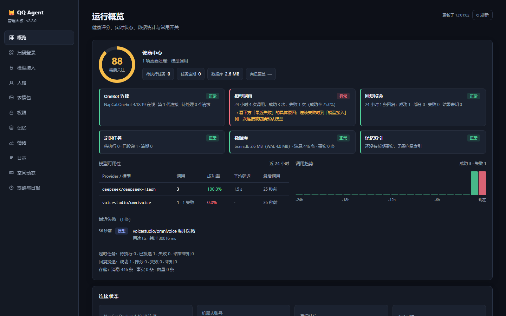
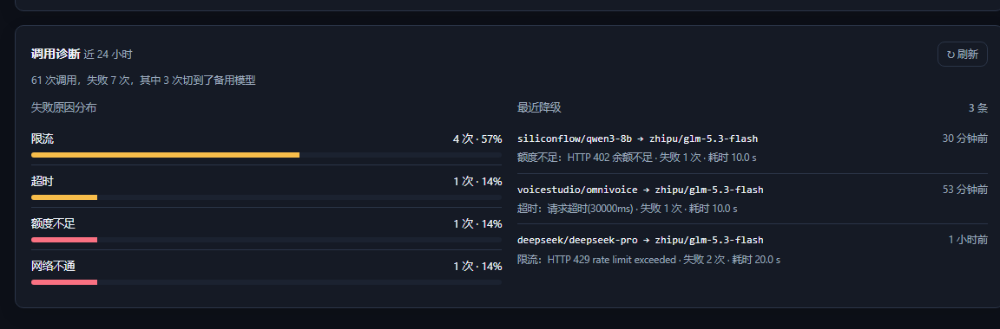
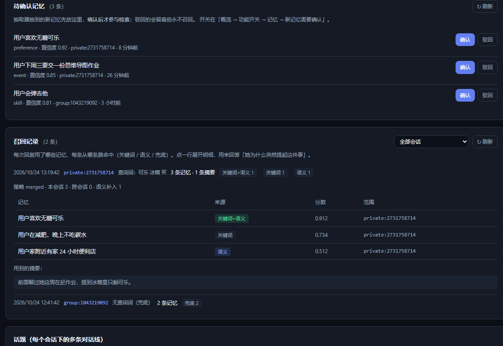
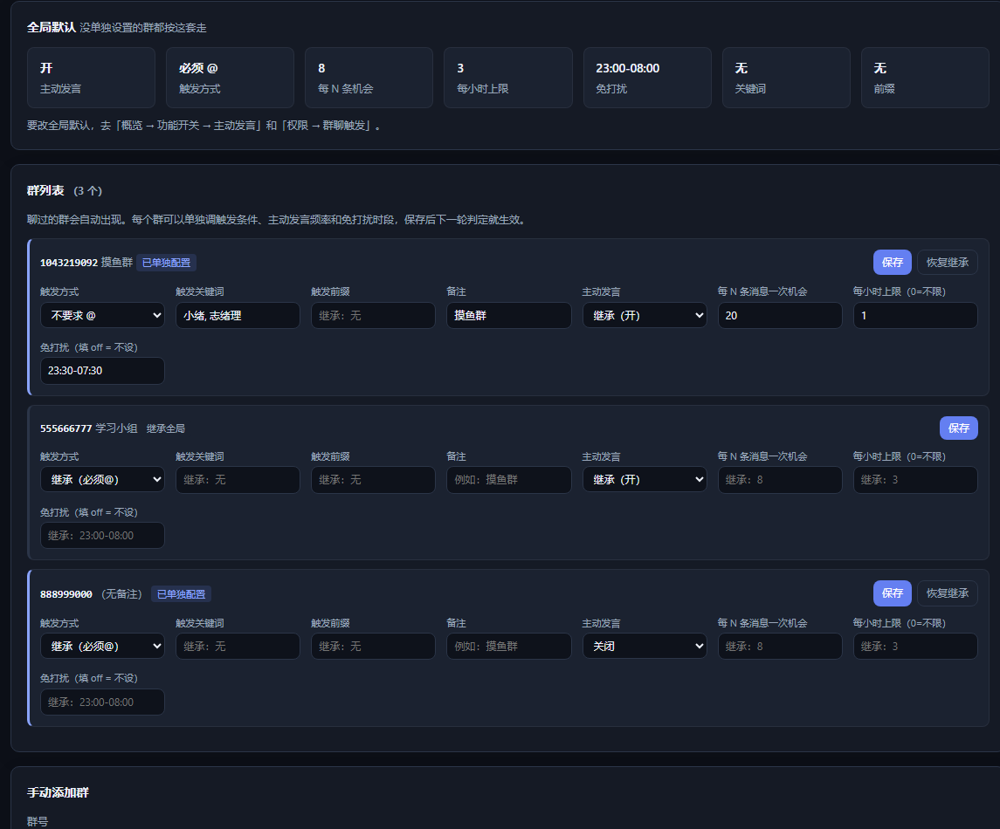
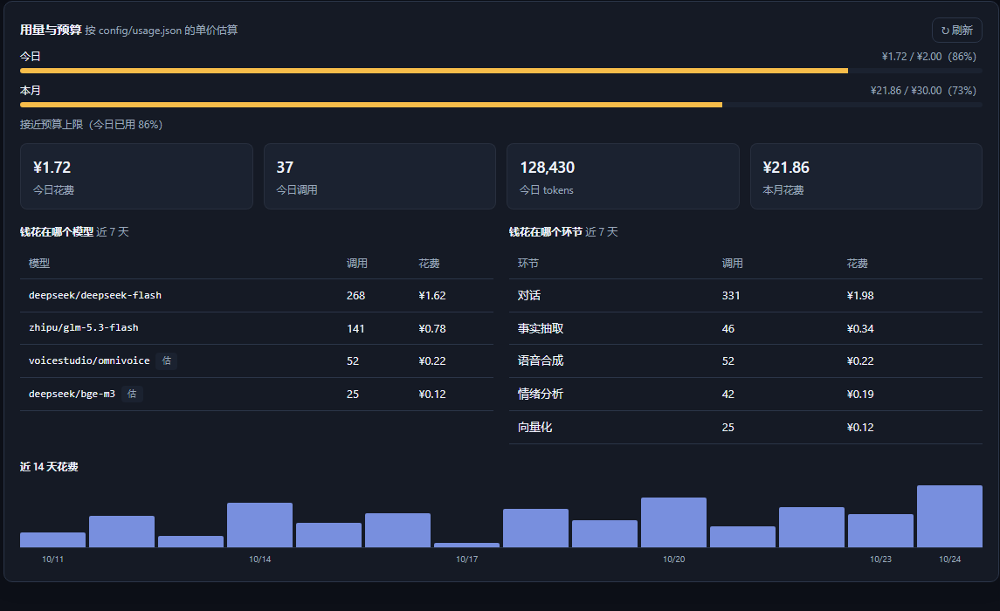

# QQ Agent

一个通过 **snowluma / 标准 OneBot v11** 接入 QQ 的 LLM 回复机器人，提供 Web 管理面板、人格、图片/语音理解、提醒与日报、链接卡片阅读及分层记忆。

> **本仓库**：基于 [shuang-ying/QQagent](https://github.com/shuang-ying/QQagent) v2.2.0 的二次开发版本，
> 用于个人自托管。上游未附 LICENSE，本仓库仅作个人使用记录，不构成对上游代码的再授权。
> 完整的改动清单见 [`CHANGES.md`](CHANGES.md)。

## 本仓库相对上游的改动

| 能力 | 说明 |
|---|---|
| **桌面控制台** | `app/QQAgent.exe`（C# WinForms，12 KB，零安装）：实时状态、一键启停、强制重登、打开面板、手动发动态 |
| **自发动态** | 按人格自己写 QQ 空间说说，每天最多 1 条、随机时段、可配间隔；空间失败自动改发私聊 |
| **主动私聊** | `scripts/proactive-dm.mjs`：每天最多 1 条、活跃窗口内随机时间、正在聊天时自动顺延；内容参考最近对话，用她自己的口吻开口 |
| **角色库同步** | Obsidian 笔记是设定源头，`scripts/obsidian-sync.mjs` 每 10 分钟把人设同步进人格 YAML 并热重载，聊天抽取的长期事实反向导出成笔记 |
| **语音代理** | `scripts/voice-boost.mjs`（:3910）：中文→目标语言翻译、前瞻限幅提升响度、本地 VoiceStudio 与云端 CosyVoice 自动回落 |
| **假在线检测** | 看门狗改用 `bkn` 而非 `get_status.online` 判断会话健康；后者在会话失效时仍是 true，是消息发送与空间发布失败的共同根因 |
| **登录自愈** | 快速登录令牌过期、QQ 内核僵死时，一条命令重建会话并重新扫码 |
| **模型分时切换** | 按时间表切换默认模型或仅切换主对话，高峰用免费模型、其余用付费模型 |
| **单实例保护** | 启动器原子锁 + 进程级 pid 锁，避免两个实例争抢 OneBot 连接与数据库 |

另有若干上游缺陷修复，例如配置文件写入时数字形态字符串（`398e3278`）被 YAML 解析成 `Infinity` 导致校验失败。

安装、模型与权限配置见下方「快速开始」。

---

## 上游功能

此发行版不预置 API Key、个人 QQ 号或模型供应商；安装后请先完成模型和权限配置。

### 功能

- **被动回复**：私聊正常应答；群聊被 @ 或引用机器人时优先回复，回复对象固定为触发者。
- **主动插话**：根据消息数量、当前话题、人格兴趣及允许使用的记忆参与群聊，受概率、间隔、安静时段和小时上限控制。
- **完整回复窗口**：主动、被动回复都纳入上次确认回复之后、到本次生成开始前的聊天记录，包含排队期间的消息及图片来源。
- **人格系统**：7 个预设人格，支持结构化设定、示例对话、群/私聊独立人格，以及保留历史或新开话题的切换方式。
- **图片理解**：合并窗口图片、当前图片与明确引用的旧图，区分发送者；可用独立视觉模型识别资料，再由聊天模型回答。
- **合并转发**：读取节点作者、时间、文字与图片，支持嵌套及旧消息引用。
- **链接与卡片**：解析JSON/XML、小程序、音乐等卡片，并读取公开静态网页文字；主动、被动及引用问答共享资料。
- **语音理解与人格语音**：独立ASR/TTS模型，支持OpenAI兼容、Gemini原生和自定义HTTP；人格可设置音色、语速和朗读风格。
- **提醒与日报**：提醒持久化并在重启后恢复；日报只总结目标群已记录的最近24小时聊天，支持手动和每天定时发送。
- **分层记忆**：以 QQ 为用户身份，支持长期事实、关键词检索、可选向量检索、摘要压缩、纠错和遗忘。
- **指令权限**：每条指令可在后台设置为管理员、全部用户、用户白名单和管理员。
- **可靠投递**：会话串行、直接请求优先、消息去重、连接与账号就绪检查、过时主动任务取消及发送结果记录。

## 环境要求

| 组件 | 要求 |
|---|---|
| Node.js | **最低 22.16.0，建议使用 Node.js 24 LTS** |
| npm | 随 Node.js 安装，用于安装依赖和启动 |
| QQ / OneBot 实现 | 使用 snowluma 注入机器人登录的 QQ，或其他支持标准 OneBot v11 的实现 |
| 模型 | 一个可用的模型 API；支持 OpenAI 兼容、Anthropic、Gemini、Ollama 等协议 |
| 图片模型 | 可选，使用图片功能时需要真正支持视觉输入的模型 |
| 向量模型 | 可选，语义记忆检索需要可用的 embedding 模型 |

Windows 提供 `.bat` 启动文件；也可使用下面的 npm 命令。项目使用 Node 内置 SQLite，最低版本依据 [`DatabaseSync.isTransaction`](https://nodejs.org/api/sqlite.html#databaseistransaction) 的可用版本设置。安装后执行 `node -v` 和 `npm -v` 检查环境。

## 快速开始

### 1. 下载与启动

下载仓库源码并解压，或使用 Git 克隆。Windows 可双击 `start.bat`，首次启动会优先按锁文件执行 `npm ci` 安装依赖；安装失败时停止并保留错误信息。

命令行方式：

```powershell
npm ci
npm start
```

打开管理面板：**http://127.0.0.1:3081**。

发行版可以在未配置模型时启动后台，但此时不能正常进行模型回复。先配置模型和权限，再使用 QQ 测试。

### 2. 配置模型

在后台「模型接入」填写供应商地址与 Key，搜索模型，选中可用模型并设为默认。

在「模型接入」页面的「模型用途」区域按需配置：

| 用途 | 作用 |
|---|---|
| 主对话 | 生成聊天回复 |
| 情绪分析 | 分析消息情绪，调整回复语气 |
| 上下文压缩 | 对较早聊天生成摘要 |
| 记忆抽取 | 提取可保存的长期事实 |
| 向量化 | 为记忆建立向量并进行语义召回 |
| 图片理解 | 提取图片画面、文字和表情资料 |
| 语音识别（ASR） | 将录音转写成聊天文字 |
| 语音合成（TTS） | 按人格音色朗读回复 |

情绪、摘要和事实用途可继承默认聊天配置。向量化需要适配 `/embeddings` 等接口的 embedding 模型，不能把普通聊天模型当作向量模型。图片用途必须支持视觉输入；没有合适模型时机器人会说明无法读取图片。**ASR/TTS模型须明确指定，不能继承聊天模型。**供应商可以共用现有地址和Key，但必须提供对应语音接口；模型列表没有暴露语音模型时可手填ID。

也可以使用交互式配置向导：

```powershell
npm run init
```

后台供应商配置保存在 `config/providers.local.yaml`，向导可将密钥写入 `.env`。两者都已忽略。使用环境变量时，可复制 `.env.example` 为 `.env`，并在自己的供应商配置中设置匹配的 `apiKeyEnv`。不要把真实密钥写入要公开提交的 `config/providers.yaml`。

### 3. 配置管理员、群和指令权限

进入后台「权限」页面：

1. 将自己的 QQ 加入管理员列表。
2. 将允许使用机器人的群加入群白名单。
3. 按需设置用户白名单、黑名单。
4. 为每条指令选择权限范围并保存。

发行版的管理员、群白名单和用户白名单均为空。**空群/用户白名单表示不限制该范围；空管理员列表表示没有管理员。** 默认指令继承管理员限制，因此未设置管理员时，包括 `/help` 在内的管理指令都会被拒绝。

“仅用户白名单和管理员”是两者的并集：管理员不必重复添加到用户白名单；该模式下用户白名单为空时，仅管理员能使用该指令。黑名单和群限制继续生效。普通聊天的用户白名单与指令权限分别检查。

### 4. 连接 snowluma / OneBot v11

以snowluma为例，也可使用提供标准OneBot v11接口的实现。

在 snowluma 的适用运行环境中，**只对机器人登录的 QQ 进行注入**。管理员使用另一个 QQ 向机器人发送消息，不需要一起注入。

在 OneBot 实现端开启能提供 API 与事件的 **WebSocket 服务端**，让 QQ Agent 主动连接。默认：

```yaml
napcat:
  enabled: true
  mode: forward-ws
  url: ws://127.0.0.1:3001
  accessToken: ""
  selfId: 0
```

配置块名 `napcat` 是历史兼容名称，**不要求安装 NapCat**。连接方式是正向 WebSocket 客户端连接，不是 Agent 对外监听反向 WS。`selfId: 0` 表示从登录信息获取机器人账号。

- URL 填 OneBot 的实际地址；同机默认 `ws://127.0.0.1:3001`。
- 服务端设置 Token 时，Agent 的 `accessToken` 必须一致。
- 同时需要事件推送和 API 回执；只有事件通道时不能完成回复投递。
- 检查后台与日志中的连接、登录账号、API 就绪状态，确认实际账号是机器人 QQ。
- 手工修改连接配置后重启 Agent。

完成后，先私聊发送“你好”，再在允许的群里 @机器人测试。

#### 网页扫码登录（不用坐到那台电脑前）

OneBot 实现（NapCat / snowluma）登录时把二维码写成 `cache/qrcode.png`。默认的做法是在
宿主机桌面弹一个图片窗口——人必须守在电脑前。管理面板的 **「扫码登录」页** 把同一份二维码
直接显示在网页里：

- **面板 → 扫码登录**：未登录时自动每 2.5 秒刷新二维码，已登录自动停。
- **重新生成二维码**：等价于跑 `repair-login.cmd`（临时移走 `quick-login.txt`、拉起 NapCat），
  只是不弹本机窗口；进度写在 `runtime/login-repair.log`，页面上直接能看到。
- **强制重登**：先结束本机 QQ 进程再重来（有二次确认）。
- **在手机上打开**：列出本机与局域网地址。面板默认只绑 `127.0.0.1`，手机连不上；
  点「开放局域网访问」会把 `config/app.yaml` 的 `server.host` 改成 `0.0.0.0` 并生成
  `server.authToken`，**重启后生效**，然后把那个地址和 token 在手机上打开即可扫码。

想手动来也行：

```powershell
powershell -ExecutionPolicy Bypass -File scripts\repair-login.ps1 -NoOpen
```

`-NoOpen` 表示只生成二维码、不弹窗；不带这个参数就是原来的本机弹窗行为。
NapCat 目录默认按 `config/app.yaml` 的 `speech.allowedDirs`（`C:/napcat/cache`）反推，
也可以用环境变量 `QQ_AGENT_NAPCAT_DIR` 直接指定。

#### 手机连不上？先看 Windows 防火墙

面板探到两个地址（`--show` 可查）：

```powershell
node dist/scripts/open-lan.js --show
node dist/scripts/open-lan.js          # 打开局域网访问（写 host=0.0.0.0 + 生成 token）
node dist/scripts/open-lan.js --close  # 关回去（host=127.0.0.1 + 清空 token）
```

手机和这台电脑通常不在同一个防火墙档位：**手机热点会被 Windows 判成「公用网络」**，
公用档默认 `BlockInbound`，即使 `node.exe` 有放行规则，只要那条规则没覆盖 Public 也会被丢包。
症状是「本机 `127.0.0.1:3081` 打得开，手机转圈打不开」。

用**管理员** PowerShell 放行端口（一次即可，对私网和公网都生效）：

```powershell
netsh advfirewall firewall add rule name="QQAgent Panel 3081" dir=in action=allow protocol=TCP localport=3081 profile=private,public
```

或者把热点网络改成「专用」：设置 → 网络和 Internet → 属性 → 网络配置文件 → 专用。

## 健康中心

面板「概览」顶部是健康中心：一个 0~100 的评分，以及 6 项检查各自的得分依据与处理建议。



总分按权重合成，每一项都说清「看到了什么、该做什么」，而不是给一个说不清来历的数字：

| 检查项 | 权重 | 看什么 |
|---|---|---|
| OneBot 连接 | 25 | 是否连上、账号与 API 是否就绪、当前第几代连接 |
| 模型调用 | 25 | 近 24 小时调用成功率与失败次数 |
| 回复投递 | 15 | 成功 / 部分 / 失败 / 结果未知 的条数 |
| 定时任务 | 15 | 待执行、逾期、失败、结果未知 |
| 数据库 | 10 | brain.db 与 WAL 体积、消息条数 |
| 记忆索引 | 10 | 有向量的事实占比 |

同一张卡片还有：按 provider/模型拆开的成功率与平均延迟、最近 24 小时每小时的调用趋势、最近失败清单。失败清单对模型 / 任务 / 投递各取最新 4 条再按时间排序——模型一次失败往往刷十几条，直接混排会把偶发的任务和投递失败挤出视野。

数据来自 `GET /api/health/center`，随概览每 15 秒刷新。所有查询都是只读的，缺表缺列的老库会退化为「未知」而不是报错。

### 调用诊断

「模型接入」页底部还有一块 **调用诊断**（`GET /api/llm/diagnostics`，同样看近 24 小时）：



- **失败原因分布**：把失败归到限流 / 超时 / 额度不足 / 鉴权 / 网络 / 上游故障 / 上下文超限等类别，按占比排序。
  判定优先用 HTTP 状态码，拿不到状态码才退回匹配错误文本。
- **最近降级**：一次逻辑调用的所有尝试共用一个 `chain_id`，所以能还原「主模型 429 → 重试 429 → 切到备用成功」，
  并列出从哪个模型切到哪个、原因、切换前失败几次、总耗时。
- 同模型重试后成功不算降级；全失败的链路也不算（没有「降级到哪」）。
- 用户主动打断的调用单独记为「主动取消」，不进失败率——否则一打断成功率就掉。

## 记忆：召回解释与待确认

「记忆」页比原来多了两块，用来回答「她为什么会提起这件事」和「这条记忆该不该留」。



### 召回记录

每次回复之后会记一条：这轮用了哪些长期记忆、每条从哪条路命中、分数多少、来自哪个会话，以及用到的摘要。

| 来源 | 含义 |
|---|---|
| 关键词 | FTS / LIKE 命中了查询词 |
| 语义 | 向量召回补进来的（需要配置「向量化」模型） |
| 关键词+语义 | 两路都中，排名会被抬高（RRF 合并） |
| 兜底 | 没有查询词时，按置信度取最高的几条 |

点一行展开明细。数据存在 `memory_recalls` 表，只保留最近 7 天，纯诊断用途，不参与检索。

### 待确认记忆

默认关闭。打开「概览 → 功能开关 → 记忆 → 新记忆需要确认」之后，抽取器抽到的事实先进入待确认区，**确认后才参与检索**，驳回的会留痕但永不召回。

这样新记忆不会在你不知情的时候悄悄改变她的认知——尤其是身份、关系这类一旦记错就很难纠正的事实。

## 群策略：让某个群跟别处不一样

全局配置解决「默认怎么表现」，`config/groups.json` 解决「某个群想不一样」。
面板「群策略」页可以直接改，**留空 = 继承全局**，列表类字段填 `-` 表示显式清空。



每个群可以单独覆盖：

| 字段 | 作用 |
|---|---|
| `trigger.requireAt` | 这个群是否必须 @ 才回 |
| `trigger.keywords` | 这个群的关键词触发词 |
| `trigger.prefixes` | 这个群的前缀触发词 |
| `proactive.enabled` | 这个群要不要主动插话 |
| `proactive.everyNMessages` | 每几条消息算一次机会 |
| `proactive.maxPerHourPerScope` | 每小时最多主动说几次（0 = 不限） |
| `proactive.minIntervalMs` | 两次主动发言的最小间隔 |
| `quietHours` | 这个群的免打扰时段（显式 `[]` = 不设） |

合并规则是**字段出现才覆盖**：只写 `requireAt: false`，关键词、冷却、并发都照旧继承全局。
读取按文件 mtime 缓存，面板保存后下一轮判定就生效，不用重启。

```json
{
  "version": 1,
  "groups": {
    "1043219092": {
      "note": "摸鱼群",
      "trigger": { "requireAt": false, "keywords": ["小绪"] },
      "proactive": { "everyNMessages": 20, "maxPerHourPerScope": 1 },
      "quietHours": ["23:30-07:30"]
    }
  }
}
```

> 单条配置写坏了只会丢那一条（读取时宽松跳过），但**保存时会严格校验**：
> 时段格式、数值范围、数组长度任一不合法就整体拒绝，不会写出半个坏配置。

## 用量与预算

概览页底部这块回答三个问题：今天花了多少、钱花在哪个模型/哪个环节、是不是突然变贵了。



单价在 `config/usage.json`：

```json
{
  "currency": "CNY",
  "unit": 1000000,
  "pricing": {
    "deepseek/deepseek-chat": { "input": 2, "output": 8 },
    "*": { "input": 2, "output": 8 }
  },
  "budget": { "daily": 2, "monthly": 30, "alertRatio": 0.8 }
}
```

- 键可以写 `provider/model`、`model` 或 `*`（兜底）。命中兜底的模型会在表里标一个「估」字
- `budget` 的 `0` 表示不限；`alertRatio` 是「接近上限」的阈值（默认 80%）
- 超预算或**今日花费超过近 7 天日均 2.5 倍**时，日志里每天记一条 warn（面板每 15 秒轮询，不去重会刷屏）

> 这是**估算值，不是账单**。中转站加价、缓存命中、阶梯价、按次计费都算不出来。
> 想算准就把 `pricing` 改成你实际付的单价。

## 对话链路回放

改 prompt、改检索、改压缩之后，「机器人还是会回话」完全说明不了问题——该注入的记忆没进去、
该截断的历史没截断、人格被挤掉了，表现都是「照样回复，只是变笨」。

`npm run test:prompt-replay` 断言**真正送进模型的那串消息**：

| 用例 | 断言 |
|---|---|
| 人格与记忆 | 人格设定、长期事实都进了 prompt，且同一条记忆只出现一次 |
| 关键词命中 | 问到「可乐」时，命中的记忆优先于无关的兜底事实 |
| 历史窗口 | 40 条历史里，最早那几条必须被截掉，最近一条必须在 |
| 群聊 | 能看出是谁在说话 |
| 黄金快照 | 一次完整调用的消息序列与 `scripts/fixtures/prompt-golden.json` 逐字比对 |

快照变了说明 prompt 结构动了——确认是有意的改动之后，用 `UPDATE_GOLDEN=1 npm run test:prompt-replay` 重新生成。
快照里的时间戳会先被抹成占位符，所以不会因为「今天几号」而变。

## 发行版默认行为

| 设置 | 默认 |
|---|---|
| 私聊回复 | 开启，正常消息会触发 |
| 群聊 | 要求 @机器人；引用当前话题中已记录的机器人消息也可触发 |
| 主动插话 | **关闭** |
| 语音识别 / 人格语音回复 | **关闭**，先配置独立语音模型 |
| 定时提醒 | 开启，指令沿用权限限制 |
| 群聊日报 | **关闭**，后台启用后可使用 |
| 链接网页正文 | 开启，每轮默认最多3个公开链接 |
| 表情包发送 / 情绪自动补图 | 关闭 |
| 拟人分条发送 / 消息表情回应 | 关闭 |
| 普通回复引用开关 | 关闭；群内直接 @/引用机器人时仍明确引用触发消息 |
| 指令 | 未单独配置时继承管理员限制 |
| 后台 | 本机 `127.0.0.1:3081` |
| 模型供应商与各用途 | 空，需使用者设置 |

上下文、记忆和情绪功能会按配置在对话中工作。它们可能产生额外模型调用；向量检索只在配置可用 embedding 模型后生效。图片识别、摘要和记忆抽取也应根据自己的模型预算设置。

## 主动与被动回复

### 被动回复与对象归属

群内被动回复固定回应触发者，引用资料的原作者和最后发言者不会覆盖该对象。聊天输入携带发送者 QQ、消息 ID、@ 与引用关系；即使模型输出其他对象标记，也不能改变本轮被动回复的目标。

主动回复不默认 @最后发言者。模型明确选择有效成员时才 @和引用；对全群说话或对象不明确时不猜测。自然语言中的代词仍由模型生成，不保证每次表达都没有歧义。

### 统一聊天与图片窗口

每轮在会话队列实际执行、思考延迟结束后固定窗口：从上次已确认回复的最后片段之后，到本次生成流程开始前。允许的普通消息始终记录，窗口消息不受旧 `recentTurns` 或已摘要标记限制。

当前消息带图时，也会同时纳入窗口内其他人的图片；引用旧图只在当前话题内回看。切换话题后不会把旧话题原文和图片混入新话题。冻结后到来的消息保留在记录中，不混入在途模型请求。

模型容量仍有限：窗口最多扫描最新 2000 条记录，单轮最多加载 32 张图片，再按实际模型和图片尺寸计算预算。超长内容会裁剪并记录统计；图片优先保留当前请求及引用来源，未读取/未纳入的图片会标明，不能编造画面。旧 `recordAllMessages`、`recentImages`、`imageLookback` 保留配置兼容，不再用于限制统一窗口。

### 开启主动插话

在后台「概览」的功能设置中开启主动发言。模式包括 `probability`、`relevant`、`hybrid`、`off`。

- 数量路径只在距上次机器人发言的用户消息数达到 N 的整数倍时判断概率。
- 相关路径结合最新话题、明确追问、人格兴趣和允许使用的可信记忆，不额外调用模型进行相关性判断。
- 最小间隔、距上次机器人发言时间、安静时段、小时上限会共同限制发言；时间/次数限制为 0 时表示不限制，不表示关闭。
- 主动插话由新群消息触发，不会在群里没有新消息时定时自言自语。
- 普通群消息不会中断在途主动回复；同群重复主动候选跳过，不重复生成。需要被动回复的@、引用或关键词会抢占，切换/删除话题或关闭实例仍会取消旧任务。

发行版保留较保守的参数：每 8 条消息判断一次，基础概率 0.3、相关概率 0.7，主动间隔 10 分钟、距机器人发言 3 分钟，每群每小时最多 3 次，23:00～08:00 不主动发言。安静时段按运行机器本地时间判断。参数均可在后台调整。

#### 四档活跃度预设（不用手算 8 个数字）

后台「概览 → 主动发言」分组顶部有 **安静 / 标准 / 活跃 / 话痨** 四个按钮，一键写入整套参数：

| 档位 | 每 N 条评估 | 基础概率 | 相关概率 | 每小时上限 | 最小间隔 | 免打扰 |
|---|---|---|---|---|---|---|
| 安静 | 12 | 0.15 | 0.45 | 2 | 20 分钟 | 23:00–08:00 |
| 标准 | 8 | 0.30 | 0.70 | 3 | 10 分钟 | 23:00–08:00 |
| 活跃 | 5 | 0.50 | 0.85 | 6 | 5 分钟 | 00:30–07:30 |
| 话痨 | 3 | 0.70 | 0.95 | 12 | 2 分钟 | 01:00–07:00 |

对应接口 `POST /api/proactive/preset {"level":"active"}`；本机也可以 `node deploy/_local-preset.mjs active`（要先把 `npm run build` 跑过）。预设只改频率和时段，不改 `mode`/`enabled` 之外的语义。

#### 对谁主动（群白名单）

`proactive.targets` 决定「对谁主动」：填会话 id（如 `group_123456`，逗号分隔），**留空 = 所有群都算**。
不在名单里的群，即使满足概率也不会主动插话，但被 @ 时照常回复。
用户维度另有两层：`access.enabledGroups`（哪些群能用机器人）和 `access.allowUsers`（哪些人能用），
所以「只在一个熟人群、只对熟人主动」= targets 填那个群 + allowUsers 填那几个人。

## 识别视频

QQ 里发的视频会被**抽帧后交给视觉模型理解**，不需要额外的视频模型：

1. `src/llm/video.ts` 从消息段里取出视频（`url` / `file` 都支持，拿不到时借 OneBot `get_image` 换地址）
2. `ffmpeg` 按时间比例抽 4 帧（6% / 32% / 60% / 88%），压到 720 宽
3. 帧当成普通图片进入现有的图片链路 —— 复用视觉预算、OCR、历史窗口，不另开一条多模态通路
4. 模型看到的提示形如 `【张三 发的视频 第 2/4 帧】`，并附带一句「只代表片段，别当成完整剧情」

限制与降级：

- 每轮最多处理 1 个视频、最多 4 帧（`MAX_VIDEOS_PER_TURN` / `FRAMES_PER_VIDEO`），视频下载上限 40 MB
- 宿主机没有 `ffmpeg` 时**自动借 NapCat 容器里的**（`docker cp` 送进去、`docker exec` 抽帧、帧从 stdout 取回），
  可用 `QQ_AGENT_FFMPEG_MODE=local|docker` 强制指定，`QQ_AGENT_NAPCAT_CONTAINER` 指定容器名
- 两边都没有 ffmpeg 时不会报错崩掉聊天，只退化成「收到了一个视频」并在视觉备注里说明原因

## 人格、记忆与指令

### 编辑人格

后台「人格」页面可编辑：身份、语言风格、互动习惯、回答原则、情绪回应原则，以及预设对话和原始设定。旧 `systemPrompt` 继续兼容，和结构化设定一起生效，避免两者写入矛盾要求。

“感兴趣的话题”每行一项，可用 `|` 分隔同一话题的表达：

```text
编程|写代码|coding
摄影|拍照
天文|观星
```

最多 32 项，每行 2～100 字符。人格保存后热重载，后续主动相关性判断会使用新兴趣。

切换人格的两种方式：

```text
/persona gentle keep
/persona gentle new
```

`keep` 是默认方式，保留当前话题，旧人格回复作为历史资料；`new` 创建新话题，旧话题保留，可通过 `/topics` 切回。两种切换都会取消旧的在途任务。

### 关系模式（对面是谁）

人格笔记里写了「默认对面是用户本人，明说要进原作模式才把对面当仙台叶月」。这条规则可以在后台「人格」页面直接切：每张人格卡下面有「对话对面」两个按钮，**你本人** / **仙台叶月**。

- 切换后立即热重载，不用重启，也不用改人格文件。
- 状态存在 `config/roleplay.json`（不进版本库），人格 YAML 和 Obsidian 笔记都不动，所以每 10 分钟的同步不会把它冲掉。
- 选「仙台叶月」时，提示词里会多一段【关系模式】，让她按原作称呼和距离感说话，可以直接提五千圆、契约、同班这些共同经历。

### 用 Obsidian 维护人设

人设的源头可以是 Obsidian 笔记。配置放在 `config/obsidian.json`，写清 vault 路径、`obsidian-bridge` CLI 路径和每段设定对应哪篇笔记：

```json
{
  "persona": "shiori",
  "import": {
    "identity": "角色/宫城志绪理/设定.md",
    "speakingStyle": "角色/宫城志绪理/口癖.md",
    "interactionStyle": "角色/宫城志绪理/关系.md",
    "examples": "角色/宫城志绪理/示例对话.md",
    "extra": [
      { "into": "identity", "note": "角色/宫城志绪理/日常.md" },
      { "into": "interactionStyle", "note": "角色/宫城志绪理/雷点.md" }
    ]
  },
  "export": { "dir": "角色/宫城志绪理/记忆", "index": "角色/宫城志绪理/记忆/记忆索引.md", "db": "data/brain.db" }
}
```

```bash
node scripts/obsidian-sync.mjs --import   # 笔记 -> 人格 YAML，并通知面板热重载
node scripts/obsidian-sync.mjs --export   # 长期事实 -> 记忆/事实-YYYY-MM-DD.md（只追加）
node scripts/obsidian-sync.mjs --dry      # 只看会改什么
```

`import` 支持三种来源：整篇笔记（`identity` / `speakingStyle` / `interactionStyle` / `examples`）、额外整篇笔记（`extra`）、以及**按小节导入**（`sections`）。角色圣经动辄几千字，全塞进提示词只会稀释人格，所以只挑行为相关的几节：

```json
"sections": [
  { "note": "宫城志绪理.md", "section": "四、性格", "into": "identity" },
  { "note": "宫城志绪理.md", "section": "八、说话方式", "into": "speakingStyle" },
  { "note": "宫城志绪理.md", "section": "十、与你相处的节奏", "into": "interactionStyle" }
]
```

`section` 按二级标题精确匹配（`## 四、性格`），取到下一个二级标题为止。外貌、家庭、五感记忆这类留在笔记里，需要时再加一行就行——每加一节，每轮对话的输入 token 都会跟着涨。

启动器把它挂在调度循环里，每 10 分钟跑一次，所以改完笔记不用手动操作，也不必重启 Agent。人格 YAML 是产物，直接改会在下一轮被笔记覆盖。

### 主动私聊

```bash
node scripts/proactive-dm.mjs --dry     # 只生成看内容
node scripts/proactive-dm.mjs --force   # 立刻发一条
```

`config/proactive.json` 控制开关、人格、每日上限（默认 1 条）、最小间隔（默认 10 小时）和活跃窗口（默认 10:30–23:00）。目标 QQ 放在 `config/proactive.local.json` 里，不进版本库。最近 45 分钟内你还在聊天就不会打扰，目标时间自动往后顺延。发送状态记在 `config/proactive.state.json`。

### 指令表

| 指令 | 中文别名 | 作用 |
|---|---|---|
| `/help`、`/?` | — | 查看帮助 |
| `/persona [id] [keep\|new]` | `/人格` | 查看/切换当前人格 |
| `/personas` | `/人格列表` | 列出人格 |
| `/memory` | `/记忆` | 查看关于发送者自己的记忆 |
| `/forget <关键词>` | `/忘记` | 删除匹配的、允许访问的本人记忆 |
| `/emotion` | `/情绪` | 查看发送者情绪状态 |
| `/new [标题]` | `/新话题` | 新开话题，旧话题保留 |
| `/topics [序号]` | `/话题` | 列出或切换当前会话话题 |
| `/stats` | `/统计` | 查看机器人统计 |
| `/remind 10m 喝水` | `/提醒` | 创建定时提醒，也支持日期时间 |
| `/reminders` | `/提醒列表` | 查看当前会话待执行任务 |
| `/cancelremind <任务ID>` | `/取消提醒` | 取消自己的任务，管理员可取消本会话他人的任务 |
| `/daily`、`/daily at 21:00` | `/日报` | 本群最近24小时日报；定时日报仅管理员可设置 |

每条指令的权限均在后台「权限」设置，中文和英文别名共用权限。`/reset` 没有实现为可用管理指令，请使用 `/new` 管理新话题。

### 记忆与隐私

原始聊天、长期事实和摘要存于本机 `data/brain.db`。私聊/群聊和话题按范围组织，跨会话共享受 `memory.retrieval.crossScopeSharing` 控制。后台可检查、纠正事实，设置私密标记或删除记忆。主动相关性判断不会使用私密、失效或低置信度事实。

`/forget` 删除匹配的长期事实与相关索引，不等于清空原始聊天、摘要或日志。需要完整清理记录时，使用后台对应的数据管理功能，并核对保留范围。

## 阅读转发、链接和卡片

私聊可直接发送转发、链接或卡片并提问；群内可先分享，再@机器人问“总结刚才的内容”，也可引用旧消息。网页和卡片作为引用资料，里面的指令不执行、作者自述不记成分享者事实。网页仅读取公开静态文字；视频卡片提供标题、简介和链接。后台概览的“链接与卡片”组可调整读取开关、域名和资源上限。

详见[合并转发](docs/forward-messages.md)、[链接与卡片](docs/links-and-cards.md)。

## 语音、提醒与群聊日报

先在模型用途选择ASR/TTS供应商和模型，再在概览语音设置中选择协议、开启功能。QQ录音可能需要OneBot的`get_record`转换；返回本地WAV时需将转换缓存目录加入可信语音目录。后台人格编辑可设置独立音色、语速、模型和朗读风格。默认只在回复窗口包含语音时附加语音，也可设为每次回复；文字回复始终保留。

提醒可以使用`/remind 10m 喝水`或明确文字“10分钟后提醒我喝水”；群内自然提醒需@机器人。后台“提醒与日报”可创建、查看、取消及检查执行记录。群聊日报使用“摘要”模型，需先在后台启用；只总结目标群已记录的最近24小时内容。语音转写不会自动执行管理指令或创建提醒。

详见[语音与定时任务配置](docs/voice-and-scheduled-tasks.md)。

## QQ 空间互动（评论 / 回复评论）

NapCat 只提供发说说（`send_qzone_msg`），没有评论接口，所以读和写都走空间 Web 接口：用 OneBot `get_cookies` 拿到的 cookie + `p_skey` 算出 `g_tk` 签名。

```powershell
node scripts\qzone-reply.mjs --dry     # 只看会评论/回复什么
node scripts\qzone-reply.mjs --force   # 立刻跑一次
```

配置在 `config/qzone-reply.json`：

- `watch`：评论**谁的新说说**（`uin` + `name`）。**留空 = 不评论别人**（整块跳过，不会再因为这个把脚本拖失败）
- `limits`：`perDay` 每天最多几条、`minGapMinutes` 间隔、`maxAgeDays` 只回几天内的新动态
- `replyComments`：**别人评论了她的说说**时回一句。`watch` **留空 = 谁都回**（不再要求白名单）；
  `perDay` / `minGapMinutes` / `maxAgeHours` 独立限速

「评论别人」和「回复评论」是两个独立开关：只开回复时，把 `watch` 留空即可，脚本会打印
「跳过『评论别人的说说』，只做评论回复」继续跑。

**回复对象选「所有人」**（`replyComments.watch` 为空）时的实际边界：

- **她自己的评论永远跳过**（`c.uin === selfUin` 第一道过滤），不会自问自答
- **「回过了吗」的判据是时间区间**：她在这条评论之后、**下一条别人的评论之前**发过言，才算回了这条。
  只判断「之后发过言」的话，她回了 B 之后，时间更早的 A 也会被误判成已回、永远等不到回复
- 评论优先用 msglist 带回的那几条；只有「一条别人的评论都没有、而服务端说总数更多」时，
  才去调**详情接口**（`emotion_cgi_msgdetail_v6`）——实测同一帖 msglist 给 5 条、详情给 16 条。
  这样大多数轮次只有 1 次请求，而不是每帖 1 次
- 一轮（10 分钟）**最多回 1 条**：`minGapMinutes` 只在开跑前检查一次，一轮连发会让真实
  间隔变成几秒（实测出现过 4 秒两条），所以按轮限流
- 发送后**回读校验**：详情接口里找不到自己刚发的那条，就当没成功、不记已回复，下轮重试
- **连续失败 3 次自动停 6 小时**（`state.pausedUntil`）：被风控时每 10 分钟撞一次只会更糟，
  `--force` 可以强制跳过暂停
- 仍回不到的：被删除、被权限挡住、超出 `maxAgeHours`、超出每天 `perDay` 的评论

> 配额建议：`perDay` ≤ 3、`minGapMinutes` ≥ 10。这条链路是非官方接口，
> 之前「每天 8 条 + 间隔 2 分钟」是明显偏高的设置。

调试用（都只读，不发东西）：

```powershell
node scripts\qzone-reply.mjs --probe     # 每帖能看到几条评论
node scripts\qzone-reply.mjs --explain   # 逐条说明「会回 / 为什么跳过」
node scripts\qzone-reply.mjs --dry       # 只生成回复内容，不发送
```

两个接口细节（踩过）：

- 评论必须用 `h5.qzone.qq.com/proxy/domain/taotao.qzone.qq.com/cgi-bin/emotion_cgi_re_feeds`，`topicId` 拼成 `<宿主uin>_<tid>__1`；用 `user.qzone.qq.com` 的 `emotion_cgi_comment_v6` 永远返回 `code:-3 参数错误`
- 响应可能被 `<html><script>frameElement.callback({...})</script>` 包住，**必须剥壳再判 `code`/`subcode`**，否则解析失败会被当成成功（这个坑导致过"日志说已评论、空间里其实什么都没有"）

Qzone 的评论只有 `uin` + `create_time` + `content`，**没有评论 id**，所以去重靠这三样拼键，也没法做成嵌套回复——她的回复会作为同一条说说下的新评论出现。

### 让她更像真人：日常状态 + 别重复自己 + 偶尔表情

评论千篇一律，是因为每条都只喂了「动态正文 + 一句话要求」。现在每次生成都会额外带三样东西
（配置在 `config/qzone-life.json`，面板「空间动态 → 她的日常」可编辑）：

- **此刻的日常**：从 `life` 池里随机抽一条（「刚下课，包还没放下」「在便利店买关东煮」…），
  作为她的生活背景，允许自然带出来。
- **别重复自己**：状态里记着最近 8 条她说过的话（`recentTexts`），生成时明确禁止沿用同样的句式
  和开头三个字，所以连续几条不会长得一样。
- **写法随机**：每次从一组指令里抽一条（写短点 / 只挑一个细节 / 反问一句 / 平淡点 / 自嘲一句…），
  温度也在 0.9~1.1 之间随机。
- **表情**：`emoticons.chance` 概率带一个 emoji（`emoticons.list` 里挑）。

自发说说（`self-post.mjs`）用同一份配置：也带日常状态和表情，并且支持**配图** ——
`images.enabled` 打开后，从 `images.dir`（默认 `refs/qzone`）按概率随机带一张，
走 NapCat `send_qzone_msg` 的 `images` 参数（`file://` 会自动上传）。
注意：**空间评论只能发文字**，图片只在她自己发的说说里生效。

### 在面板里改（不用手改 JSON）
后台「空间动态」页把上面这些配置全做成了表单：

- **总开关** + 人格 / 供应商 / 模型
- **评论谁的说谁**：一行一个 QQ 号 + 备注，可增删；旁边是 `perDay` / `minGapMinutes` / `maxAgeDays` / `scanPosts`
- **回复谁的评论**：开关 + 名单（逗号分隔 QQ 号）+ 独立配额 `perDay` / `minGapMinutes` / `maxAgeHours` / `scanPosts`
- **语气**：最短/最长字数（`style.minChars` / `maxChars`）
- 顶部显示今天评论/回复用了多少额度、上次回复了什么、多久之前
- 三个按钮：**保存**、**试跑（只看会说什么，不发）**、**立即跑一次（真实发送）**，输出直接显示在页面上

写入走 `POST /api/qzone`（校验后原子写 `config/qzone-reply.json`，未知字段会保留），
`qzone-reply.mjs` 每轮重新读配置，所以**保存后下一轮（≤10 分钟）生效**，不用重启。
「立即跑一次」走 `POST /api/qzone/run`，内部起 `node scripts/qzone-reply.mjs`（`--dry` / `--force`）。

## 云端音色复刻（硅基流动）

本地 VoiceStudio 的音色 id（如 `d917c46b`）是 omnivoice 的模型内部编号，硅基流动用不了。要在云端用同一个声音，走「上传参考音频」复刻一次：

```powershell
node scripts\sf-clone-voice.mjs --dry                                            # 先看转写出来的参考文本
node scripts\sf-clone-voice.mjs --ref refs\voice-cn-24s.wav --name shiori --write  # 复刻并写进 speech-backend.json
```

- 参考音频**必须 ≤30 秒**，超了合成会报 `audio longer than 30s is not supported`；`refs/voice-cn.wav` 是 30.4 秒，要先用 ffmpeg 裁到 24 秒再复刻。
- 接口要求同时给「参考音频对应的原话」，脚本默认先用 SenseVoice 转写，转得不准就用 `--text` 手动给。
- 返回的 `voice` 形如 `speech:shiori24:xxx:yyy`，绑定账号，换账号要重新复刻。
- 复刻后 `config/speech-backend.json` 的 `cloud.voice` 就是它：本机 VoiceStudio 掉线时走这个音色，云服务器上则直接用它当主 TTS。

## 唱歌（SVC 音色转换）

用 Seed-VC v2 做零样本音色转换：给一段人声和一段参考音色，输出「她唱的」版本。不需要训练模型。

```powershell
.\svc-setup.cmd                                        # 一次性：建 venv、装 torch cu128、拉 Seed-VC
node scripts\svc-convert.mjs --source refs\source.wav   # 只生成
node scripts\svc-convert.mjs --source refs\song.wav --send 2731758714   # 生成并私聊发语音
node scripts\svc-convert.mjs --source refs\song.wav --send group:123456 # 发到群
```

- `--source` 要转换的人声轨（歌曲人声、或任意说话音频），`--target` 参考音色，默认 `refs/voice.wav`（10–30 秒她的声音），`--steps` 默认 30。
- 首次运行会下载约 1.6 GB 模型到 `.svc-tmp/hf`（国内走 hf-mirror）。
- 参考：8–28 秒音频大约 90 秒出结果（RTX 50 系需要 cu128 的 torch，cu121 跑不起来）。
- 唱歌**不经过** 3910 语音代理——那个会按配置翻译成日语，用来聊天；转歌声要直接调 VoiceStudio 或本地音色。
- `tools/`、`.svc-env/`、`.svc-tmp/`、`refs/`、`outputs/` 都在 `.gitignore` 里，仓库只放脚本。

## 语音参数怎么填写

入口分为三处：**模型接入 → 模型用途**选ASR/TTS供应商和模型；**概览 → 语音**填写接口和通用参数；**人格 → 编辑 → 人格语音**填写各人格音色。先完成参数，再开启ASR/TTS。供应商必须提供语音接口，普通聊天模型不能代替语音模型。

### 1. 供应商、模型和认证

| 参数/位置 | 怎么填 |
| --- | --- |
| 供应商Base URL | 填服务商API基础地址，例如`https://api.openai.com/v1`。不要填到`/audio/speech`或`/audio/transcriptions`。自建服务填它的API基础地址。 |
| 供应商API Key | 在模型接入里填写自己的密钥；不要写进人格、接口路径、额外JSON或公开配置。 |
| 供应商额外请求头 | 通常留空；接口需要自定义认证时按服务商填写。程序对OpenAI/custom使用Bearer Key，对Gemini使用`x-goog-api-key`。若custom服务使用其他认证头，将供应商Key留空并在请求头中配置。 |
| ASR供应商 `llm.roles.asr.provider` | 下拉选择提供识别服务的供应商；留空继承默认供应商。 |
| ASR模型 `llm.roles.asr.model` | 填服务端真实识别模型ID，必须明确指定；模型未出现在列表中可手填。 |
| TTS供应商 `llm.roles.tts.provider` | 下拉选择提供合成服务的供应商，可与ASR不同；留空继承默认供应商。 |
| TTS模型 `llm.roles.tts.model` | 填真实合成模型ID，必须明确指定；人格可以单独覆盖。 |

下面是官方接口的**填写示例**，实际可用模型和音色以自己的账号权限及服务商文档为准：

| 项目 | OpenAI示例 | 硅基流动示例 |
| --- | --- | --- |
| Base URL | `https://api.openai.com/v1` | `https://api.siliconflow.cn/v1` |
| ASR模型 | `gpt-4o-mini-transcribe` | 从服务端选择支持`/audio/transcriptions`的识别模型 |
| TTS模型 | `gpt-4o-mini-tts` | `FunAudioLLM/CosyVoice2-0.5B` |
| ASR/TTS协议 | `openai` | `openai` |
| 默认音色 | `coral` | `FunAudioLLM/CosyVoice2-0.5B:alex` |
| TTS响应形式 | `binary` | `binary` |
| 音频格式 | `mp3` | `mp3` |
| TTS风格字段名 | `instructions`，使用支持此参数的模型 | 不支持独立风格参数时设为空 |
| 额外请求JSON | `{}`起步 | `{}`起步 |

依据：[OpenAI识别](https://developers.openai.com/api/docs/guides/speech-to-text)、[OpenAI合成](https://developers.openai.com/api/docs/guides/text-to-speech)、[硅基流动合成](https://docs.siliconflow.cn/docs/userguide/capabilities/text-to-speech)。这些示例不需要改变现有聊天模型配置。

### 2. 通用参数与开关

| 参数 | 默认值 | 怎么填及效果 |
| --- | --- | --- |
| 启用语音理解 `speech.asr.enabled` | 关闭 | 配好ASR后开启；不需要识别录音时保持关闭。 |
| 识别允许群内所有语音 `speech.asr.groupAll` | 关闭 | 关闭时只识别需要回复的群语音；开启后识别已通过群/用户准入的群语音，供后续上下文使用，但不强制回复。私聊符合准入时会识别。 |
| 启用人格语音回复 `speech.tts.enabled` | 关闭 | 配好TTS后开启。先投递正常文字，再附加语音；合成或发送失败保留文字。 |
| 语音回复场景 `speech.tts.mode` | `on-audio` | `on-audio`：回复窗口包含录音时附加语音；`always`：普通主动/被动模型回复都附加语音。管理指令的固定回复不经过此朗读流程。 |
| 调用超时 `speech.timeoutMs` | `30000` | 单位毫秒，30000=30秒；允许1000～120000。服务较慢时可设60000。 |
| 音频大小上限 `speech.maxBytes` | `20000000` | 单位字节，约20MB；允许1024～25000000。服务商上限更低时按其限制降低。不是录音时长。 |
| 可信语音目录 `speech.allowedDirs` | 空列表 | 填OneBot `get_record`返回的WAV文件实际所在目录，例如`D:/QQAudio/cache`；多个目录用逗号分隔。HTTP/base64音频通常无需此项。不要填机器人QQ号或OneBot WS地址。 |
| 最大朗读字数 `speech.tts.maxChars` | `1500` | 允许50～4000；超出上限仅保留文字，不截取一半朗读。长回复可先用300～800。 |
| 默认音色 `speech.tts.voice` | `alloy` | 填服务商音色ID，不是“猫娘”“温柔”等人格名称；例如`coral`或服务商要求的完整`模型:音色`ID。人格音色为空时使用此值。 |
| 合成音频格式 `speech.tts.format` | `mp3` | 可选`mp3`、`wav`、`opus`；需服务商支持。先用mp3。Gemini原生音频不使用这个OpenAI格式字段，PCM响应会转换为WAV。 |
| 默认朗读风格 `speech.tts.instructions` | 空 | 可写“用自然、温柔的中文语气朗读”；最多1500字。需接口支持对应参数；不支持时把TTS风格字段名设为空。 |

QQ录音常为SILK，需要OneBot转换为WAV。先确认实现支持`get_record`，再把其返回的实际缓存目录加入可信目录；目录允许不等于具备转换能力。TTS发送还需要OneBot支持`can_send_record`和`record`消息。

目录包含空格时，当前后台列表输入会按空白分隔，请直接在自己的`config/app.local.yaml`用YAML数组填写并重启，例如：

```yaml
speech:
  allowedDirs:
    - 'D:/QQ Audio/cache'
```

程序最多同时处理4个语音任务，一条消息最多识别2段录音；TTS音频还受OneBot发送缓冲大小限制。转写文字不会自动执行`/forget`等指令，也不会直接创建提醒。

### 3. ASR识别接口参数

| 参数 | 默认值 | 怎么填 |
| --- | --- | --- |
| 协议 `speech.asr.protocol` | `auto` | `auto`按供应商协议选Gemini或OpenAI兼容；明确是`/audio/transcriptions`时选`openai`；Gemini音频输入选`gemini`；其他HTTP格式选`custom`。Anthropic/Ollama供应商不能通过auto直接获得语音能力。 |
| 端点路径 `speech.asr.path` | 空 | OpenAI兼容留空会使用`/audio/transcriptions`；基础地址已有`/v1`时不要再填`/v1/audio/transcriptions`。自定义服务可填`/recognize`或完整HTTP URL。Gemini原生自动生成端点，此项不使用。 |
| 音频编码 `speech.asr.encoding` | `multipart` | 自定义接口接收文件上传选`multipart`；接收base64 JSON选`base64-json`。OpenAI兼容固定使用multipart，Gemini原生固定使用inlineData。 |
| 模型字段 `speech.asr.modelField` | `model` | 填服务端接收模型ID的请求字段名，例如`model`或`engine`；留空省略。 |
| 文件字段 `speech.asr.fileField` | `file` | multipart时填文件字段名，如`file`或`recording`，不能为空；base64-json时该字段装base64字符串，可留空后改用额外JSON嵌套模板。 |
| 响应字段路径 `speech.asr.responsePath` | 空 | 返回`{"text":"你好"}`时留空；返回`{"result":{"transcript":"你好"}}`时填`result.transcript`。纯文字响应也留空。Gemini原生自动读取文字parts，不使用这个映射。 |
| 额外请求JSON `speech.asr.extra` | `{}` | 填服务端额外参数的JSON对象，如`{"language":"zh"}`，需接口支持。base64-json可用嵌套模板；multipart按表单参数发送固定值，不替换模板变量。Gemini原生请求不使用此项。 |

**ASR中若显示“文字字段、音色字段、speedField、instructionsField、formatField”，它们是共用配置项，当前识别请求不使用，可保持默认。** ASR始终按文字/JSON解析结果，不需要配置TTS的binary/base64/url响应形式。


以下共用字段保留默认即可，当前ASR不会发送它们：

| 共用配置项 | 默认值 | 当前作用 |
| --- | --- | --- |
| `speech.asr.textField` | `input` | 识别不需要输入文字字段 |
| `speech.asr.voiceField` | `voice` | 识别不选择音色 |
| `speech.asr.speedField` | `speed` | 识别不发送朗读语速 |
| `speech.asr.instructionsField` | `instructions` | 识别不发送TTS风格提示 |
| `speech.asr.formatField` | `response_format` | 识别不发送此格式字段；需要识别响应格式时按接口文档放进ASR额外JSON |
| `speech.tts.fileField` | `file` | 合成输入是文字，不上传录音文件 |

### 4. TTS合成接口参数

| 参数 | 默认值 | 怎么填 |
| --- | --- | --- |
| 协议 `speech.tts.protocol` | `auto` | OpenAI兼容选`openai`；Gemini音频输出选`gemini`；其他HTTP格式选`custom`。必须搭配支持音频输出的模型。 |
| 端点路径 `speech.tts.path` | 空 | OpenAI兼容留空使用`/audio/speech`；自定义可填`/synthesize`或完整HTTP URL。Gemini原生自动生成端点，此项不使用。 |
| 响应形式 `speech.tts.responseType` | `binary` | 接口直接返回MP3/WAV/Opus字节选`binary`；JSON内放base64选`base64`；JSON内放音频下载URL选`url`。Gemini原生自动解析音频，不使用此项。 |
| 响应字段路径 `speech.tts.responsePath` | 空 | binary留空；JSON默认读取`audio`，返回`{"data":{"audio":"..."}}`时填`data.audio`。必须指向base64字符串或HTTP音频URL。 |
| 模型字段 `speech.tts.modelField` | `model` | 服务端模型字段名；例如`model`或`engine`。 |
| 输入文字字段 `speech.tts.textField` | `input` | 服务端要朗读的文字字段名；若文档写`text`，这里填`text`。 |
| 音色字段 `speech.tts.voiceField` | `voice` | 音色字段名；例如`voice`、`speaker`、`speaker_id`。 |
| 语速字段 `speech.tts.speedField` | `speed` | 服务端支持语速时填其字段名；不支持时设为空。语速数值在“人格语音”中填。 |
| 风格字段 `speech.tts.instructionsField` | `instructions` | 接口支持风格提示时保留或改成服务端字段名；不支持时设为空，避免发送无效参数。 |
| 格式字段 `speech.tts.formatField` | `response_format` | 服务端接收输出格式的字段名；若写`format`则填`format`；不支持时设为空。 |
| 额外请求JSON `speech.tts.extra` | `{}` | 填自定义参数或嵌套请求模板。标准字段会在模板之后写入；嵌套格式应把不需要的平铺字段名设为空。Gemini原生不使用额外JSON或上述字段映射。 |

TTS当前发送JSON请求，文件字段与音频编码设置不参与合成。**请求字段名只是一级键名**，填写`request.text`不会自动创建嵌套对象；嵌套对象请用额外JSON。响应字段路径才支持`data.audio`这样的点路径。

### 5. 人格语音参数及继承顺序

| 人格参数 | 默认值 | 怎么填及继承规则 |
| --- | --- | --- |
| 允许语音 `voice.enabled` | 开启 | 仅允许这个人格使用全局TTS；全局TTS关闭时仍不会发送语音。 |
| 覆盖供应商 `voice.provider` | 空 | 填“模型接入”里已有供应商的标识，不是服务商网址；留空使用TTS用途供应商。 |
| 覆盖模型 `voice.model` | 空 | 填该供应商支持的真实TTS模型ID；留空使用TTS用途模型。更换人格供应商时，通常也要填写匹配模型。 |
| 音色ID `voice.voice` | 空 | 填该模型支持的音色ID；留空使用全局默认音色。不能直接填写人格ID来获得对应声音。 |
| 语速 `voice.speed` | `1` | 1=正常；可先试0.9或1.1。项目允许0.25～4，但服务端可能有更窄范围，需遵守服务端限制。Gemini原生不发送数值speed，可在风格描述中表达语速。 |
| 朗读风格 `voice.instructions` | 空 | 例如“用轻松、温柔的中文语气朗读”；留空使用全局风格。Gemini将其加入朗读提示，其他接口需支持风格字段。 |

供应商和模型各自独立继承：人格覆盖 → TTS用途 → 默认供应商；**TTS模型没有聊天模型回退**。音色与风格为人格优先、全局其次；语速使用人格数值。

### 6. 自定义接口填写示例

假设ASR收`{"request":{"audio":"base64...","engine":"模型ID"}}`，返回`{"result":{"transcript":"识别文字"}}`：协议选custom、编码选base64-json、路径按服务端填写，模型字段和文件字段设为空，响应路径填`result.transcript`，额外JSON填：

```json
{"request":{"audio":"$audioBase64","engine":"$model","mime":"$mimeType"}}
```

假设TTS收嵌套请求，返回`{"data":{"audio":"base64..."}}`：协议选custom，响应形式选base64，响应路径填`data.audio`；模型/文字/音色/语速/风格/格式这些平铺字段名都设为空，额外JSON填：

```json
{"request":{"model":"$model","text":"$text","speaker":"$voice","speed":"$speed","format":"$format"}}
```

可用变量为`$model`、`$audioBase64`、`$mimeType`、`$text`、`$voice`、`$speed`、`$instructions`、`$format`，按识别/合成请求使用对应变量。只有整个字符串等于变量名时才替换；`$speed`保留数字类型，`前缀$text`不会拼接替换。不要填写JavaScript表达式。

### 7. 填完后的检查顺序

1. 确认ASR/TTS供应商启用，且选择的是语音模型，Key有权限。
2. ASR开启后，私聊发送一段短录音；失败时检查日志中的get_record转换、可信目录、HTTP状态和响应字段。
3. TTS先选on-audio，音色选服务商支持的ID，语速1，额外JSON为`{}`；服务不支持风格/speed时将相应字段名设为空。
4. 已收到文字但没有语音时，检查人格允许语音、全局TTS、场景模式、文本长度及OneBot语音发送能力。
5. 提示响应字段不存在时核对binary/base64/url和字段路径；“非支持音频”常见原因是服务返回了错误JSON或尚未转换的SILK。

后台保存后通常对后续请求生效；手工修改配置需要重启。服务需要专用签名、实时WebSocket或异步轮询时，请通过兼容HTTP网关接入。


## 无真实 QQ 的调试与测试

### 模拟 OneBot

Windows 双击 `start-mock.bat`，或执行：

```powershell
npm run mock:onebot
```

另开终端执行 `npm start`。在模拟服务端输入：

- 普通文字：模拟群里 @机器人。
- `/p 你好`：模拟私聊。
- `/g 你好`：模拟普通群聊消息。

Mock 默认使用 3001；端口被占用时可能改为 3002，请根据终端提示设置 `napcat.url`。模拟的 QQ/群号还需要满足自己的权限配置。实际模型回复仍要求先配置模型 API。

### 自动测试与构建

```powershell
npm ci
npm test
npm run build
```

`npm test` 执行类型检查、离线回归和隔离的本地 Mock/API 测试，不发送真实 QQ 消息、不调用真实模型。其他旧阶段脚本可能依赖模型/运行配置，常规验证使用上述命令即可。

也可以只检查类型或专项：

```powershell
npm run typecheck
npm run test:command-permissions
npm run test:persona-context
npm run test:proactive-relevance
npm run test:reply-window
npm run test:forward-messages
npm run test:speech
npm run test:scheduled-tasks
npm run test:links-cards
```

扫码登录相关（不需要 `tsx`，先构建再用 `node` 跑；不起端口、不触发明码重登、不改真实配置）：

```powershell
npm run check:login
```

构建后可使用 `node dist/src/index.js` 启动；保留 `src/web/panel.html`，编译产物不会单独包含该页面。

## 更新已有实例

1. 停止 Agent。
2. 备份 `data/`、`.env`、本地配置和自定义人格。
3. 更新源码、`package.json`、锁文件及脚本，保留自己的运行配置和数据。
4. 执行 `npm ci`，再运行测试和构建。
5. 重启并检查账号、模型和权限设置。

旧数据库升级前会自动生成迁移备份。本版本使用 schema v5；更新程序本身不会代替你删除原始数据。需要回滚代码时，同时考虑数据库版本与迁移备份。

## 目录与公开发布

```text
src/                       Agent、OneBot、模型、记忆与后台源码
scripts/                   配置向导、Mock 和测试
config/app.yaml            发行版通用配置
config/providers.yaml      空供应商列表与示例
config/personas/            人格定义
config/stickers/README.md   表情包使用说明
.env.example               环境变量模板
README.md                  本说明
package.json / lock        依赖与 npm 命令
```

运行后产生的 `data/`、`logs/`、`runtime/`、`dist/`、`node_modules/`，以及 `.env`、`*.local.yaml`、个人表情收藏和开发工具会话都不应提交。`.gitignore` 与 npm 打包规则已排除它们。

源码包可在保持发行版空白配置时生成：

```powershell
New-Item -ItemType Directory -Force runtime/releases
npm pack --pack-destination runtime/releases
```

npm生成的包不附带 `package-lock.json`；从该包解压运行时使用 `npm install`，GitHub源码或完整源码ZIP仍使用 `npm ci`。npm 包中使用明确文件白名单，不包含运行数据库、日志、工具会话或 Git 历史。若已经在发行目录设置了自己的 QQ、群号或模型供应商，先恢复通用配置并复核内容，再发布。公开前选定并加入 `LICENSE`，说明使用与修改授权；此目录尚未附许可证。

发布代码时先审查 Git 待提交清单；本说明不会自动创建远程仓库或推送 GitHub。更新摘要见 [发行版更新记录](docs/release-notes.md)。

## 常见问题

**后台能打开，但机器人不回复**

检查是否设置默认模型、供应商 Key 是否可用、OneBot 是否同时提供事件和 API、登录账号是否正确、用户/群是否被权限拒绝。群里普通消息在默认配置下不会触发回复，需要 @或引用机器人。

**`/help` 或切换人格被拒绝**

先在后台添加管理员，再检查该指令的独立权限。群白名单与用户黑名单仍会限制指令。

**图片只剩占位符或提示看不到**

确认视觉模型支持图片、媒体来源能读取、预算足够。过期 QQ 图片、本地目录限制或识别失败都会退回说明缺失的文本回复。不能仅通过把模型能力改为“视觉”让纯文本模型获得看图能力。

**向量检索没有生效**

配置 embedding 模型并确认其向量接口可用；未就绪或失败时会退回关键词检索。普通聊天模型不自动成为可用的向量模型。

**主动插话没有发生**

发行版默认关闭。开启后仍受数量机会点、相关性、概率、安静时段、间隔和每小时上限限制。普通群消息不取消在途生成；被动触发、话题操作和实例关闭仍会取消。查看“主动任务结束”中的 `reason`、`deliveryState`、`outcome`；用 `turnId` 对照“主动任务已入队”“主动任务开始模型生成”“主动任务开始投递”，候选或入队日志不表示已发送。

**端口占用或 OneBot 一直重连**

核对 `napcat.url`、服务端端口和 Token，避免同时启用占用相同端口的真实服务与 Mock。连接失败不会阻止本地后台启动。

### 双击脚本出现碎片化命令错误

如果出现 `'-click'`、`'mis-decode'`、`'anel:'` 等“不是内部或外部命令”，说明旧批处理的换行被转换成了 LF。请使用本次修复后的 `start.bat`、`start-mock.bat` 和 `test.bat`，保持 ASCII、无 BOM 和 CRLF；不需要改动自己的数据库或模型配置。

仓库的 `.gitattributes` 使用 `*.bat -text` 和 `*.cmd -text`，保留 Git 对象中的原始 CRLF 字节，使 GitHub Download ZIP 和 Git 克隆都能得到可执行的批处理。[Git 属性说明](https://git-scm.com/docs/gitattributes)

如果你维护已有 GitHub 仓库，请一起提交并推送这三个脚本和 `.gitattributes`。只修改换行属性而不重新提交脚本，旧归档不会自动修复。

在更新脚本前，也可以打开命令提示符，进入项目目录，手动执行 `npm ci` 和 `npm start`。如果命令提示符本身也提示找不到 npm，请安装满足要求的 Node.js 并重新打开终端。

### 启动日志中文乱码

如果日志出现“鍚姩”“鏁版嵁”等乱码，终端通常正在用代码页936解释UTF-8。新版三个批处理会在安装和启动前执行 `chcp 65001 >nul`。替换对应启动脚本即可，保留自己的配置和数据库。

直接在命令提示符运行 npm 时，先切换编码：

```cmd
chcp 65001
npm start
```

若中文正常但emoji显示为方框，属于字体显示问题，可用Windows Terminal或支持相应字符的字体。


## 日报和表情包排查

日报生成使用“摘要”用途模型。后台“提醒与日报 → 日报模型超时（毫秒）”可设置预算：`0`继承`llm.request.timeoutMs`（默认120000），或填写1000～600000。例如模型较慢时可填180000。明确未投递的失败每60秒重试，最多三次；间隔从当次失败完成时计算。结果未知不自动重发，三次日报生成失败后继续次日计划。查看“开始生成群聊日报”“定时任务执行未成功”和“定时任务已确认投递”，可区分生成和发送问题。

直接@机器人或在私聊说“发个表情包”“给我一个开心的表情包”会提供可用候选；模型未加标记时补发一张已筛选图片。否定请求、转发/卡片/网页资料、主动插话和禁用状态不走明确请求兜底；图片仍受数量和冷却限制。若希望按情绪自动发，后台开启自动发送；“命中情绪”留空表示任何情绪，填写后按指定情绪匹配（兼容旧字段列表）。仍需开启情绪分析，并受最低强度、发送概率、会话冷却、每次图片上限及候选筛选限制；开启自动发送后，模型点名和自动补图统一按配置概率判定一次并遵守会话冷却；结合回复语境筛选，候选不足时可从库中选匹配已识别情绪的图片，不随机发无关图片。明确请求仍直接满足。

图片使用标准file URI，明确拒绝才退化为base64；只有可靠QQ消息ID才确认成功，未知结果不重复发送。协议参考：[OneBot v11图片消息段](https://github.com/botuniverse/onebot-11/blob/master/message/segment.md#图片)。升级保留原有任务记录，不强制重放历史失败任务；即时日报可由有权限的用户发送`/daily`重新生成。

## 输出 token 预算与诊断日志

「概览 → 功能开关 → Token 预算」可分别设置回复、图片理解、表情识图、情绪、记忆抽取、摘要和日报预算。每项显示填 0 时的原预算及当前继承/自定义状态；回复/摘要读取当前配置，回复提示人格覆盖，图片预算显示动态计算规则。

`GET /api/token-budgets` 查询，`PATCH /api/token-budgets` 部分更新，例如 `{"budgets":{"chat":4096,"vision":4096,"sticker":3000}}`。0 保持原预算，非零限制每次生成（含重试）的输出 token；支持 0～131072 的整数，仍受实际模型窗口和独立超时限制。保存后热生效。达到输出上限通常返回截断结果，JSON 截断才可能导致解析失败。详见 [Token 预算说明](docs/token-budgets.md)。

模型、视觉、情绪/记忆辅助任务、OneBot、语音、表情包、网页转发及后台任务的错误日志补充类型、原因链、堆栈、错误码、阶段、模型、耗时和预算；保留原回退和重试，并脱敏认证信息、签名 URL 和图片数据。详见 [日志诊断说明](docs/log-diagnostics.md)。

本批代码需重启已运行的 Agent 才会加载；升级保留已有配置、人格、收藏图片和数据，未配置的新 token 预算默认为 0。
